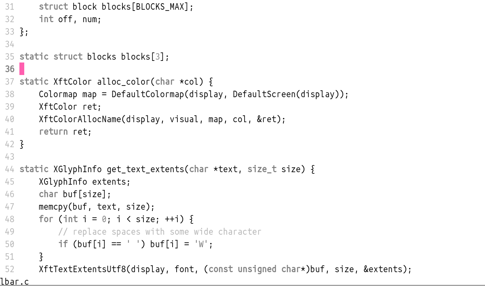
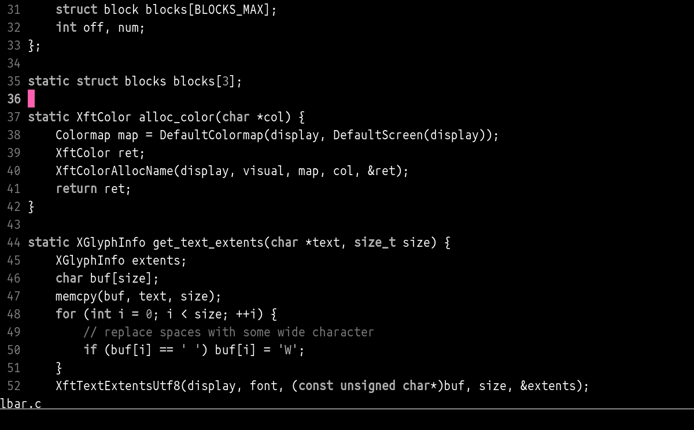

<h1 align="center">Simp</h1>

Monochromatic theme for vim.

Simp is a plain light/dark colorscheme that doesn't get in your way,
built on top of [momo.vim](https://github.com/miublue/momo.vim)
because i felt like making a new one.

# Preview

